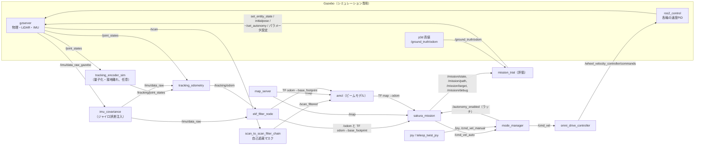
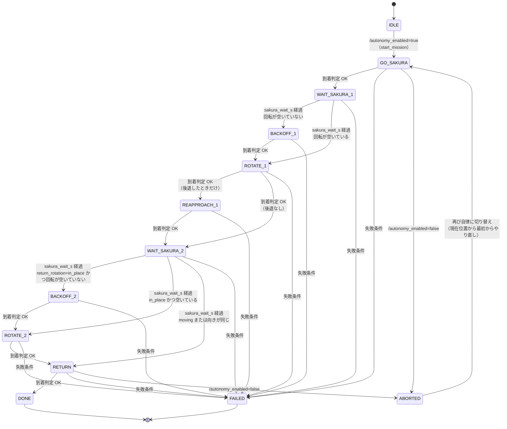

# 設計の概要（フェーズ5「誤差の組み合わせ試験」に入る前の確認用）

対象: `ros2_ws/`（ROS 2 Humble / Gazebo Classic 11）。コードを読んで書いた資料で、この資料のために
コードの変更やシミュレーションの実行はしていない。関数名・パラメータ名は現在のコードのもの。
「仮値」は実機の仕様や測定が未確定のもの（コード中のコメントの `仮値` に合わせた）。

---

## 1. 全体構成

### 1.1 パッケージ

| パッケージ | 役割 | 実機で使う? |
|---|---|---|
| `omni_robot_description` | ロボット寸法の唯一の定義（`config/robot_geometry.yaml`）、読み出し関数（`geometry.py`）、URDF（`urdf/omni_robot.urdf.xacro`） | 寸法・`geometry.py`・URDFの形状部分は実機でも使う。URDF内の `<gazebo>` タグ、センサのプラグイン、真値（p3d）、誤差注入の引数は**シミュレーション専用** |
| `omni_robot_odometry` | `tracking_odometry`: 計測輪2つ＋IMUのヨー角速度から平面オドメトリ（`/tracking/odom`） | **実機でも使う**（シミュレーションと共通） |
| `omni_robot_mission` | `sakura_mission`（`mission_node.py`: 往復ミッションの状態機械と追従制御）、`mode_manager`（手動/自律の切り替え、`/cmd_vel` の唯一の出力元）、`trajectory.py`（経路平滑化・速度計画・追従則・指令の整形）、`collision.py`（占有格子との衝突判定）、`route_graph.py`（通過点グラフ） | **実機でも使う**（`mission.launch.py` は共通） |
| `omni_robot_nav2` | 地図（`maps/field_map.*`）、AMCL設定（`config/amcl.yaml`）、`localization.launch.py`（LiDAR自己遮蔽マスク → map_server → AMCL） | 地図・AMCL・マスクは実機でも使う。`navigation.launch.py`、`nav2_params.yaml`、`navigate_to_goal.py`、`route_experiment.py`、`config/mission.yaml` は最初期のNav2実験用（現在のミッションは使わない） |
| `omni_robot_gazebo` | シミュレーション環境と評価ツール（下の1.2） | **シミュレーション専用**（ただし `omni_drive_controller` の運動学は実機のモータ指令側に相当するものが別途必要） |
| `omni_robot_bringup` | launch の組み合わせ（`sim_check`、`sim_mission`、`experiment`、`simulation`）、RViz設定 | シミュレーション用 |

### 1.2 実機でも使う部分 / シミュレーション専用の部分

| 区分 | 内容 |
|---|---|
| 実機でも使う | `tracking_odometry`、`robot_localization` の EKF（`config/ekf.yaml`、置き場は `omni_robot_gazebo` だが設定自体は共通）、AMCL＋`amcl.yaml`＋地図、`laser_filters` による自己遮蔽マスク、`sakura_mission`、`mode_manager`、`trajectory.py` ほか、`robot_geometry.yaml`、PS4操作（`teleop_ps4.yaml`） |
| シミュレーション専用: 環境 | `worlds/`、`models/kansai_field_2027/model.sdf`（`field_layout.py` が `field_layout.yaml` から生成）、`gazebo.launch.py`、ros2_control の Gazebo プラグイン、物理（ODE、1 ms ステップ） |
| シミュレーション専用: 誤差の注入 | `config/sim_conditions.yaml` と、それを読む `gazebo.launch.py`（スポーン時のモデルの誤差: LiDAR取り付け誤差、計測輪の径・位置・角度、駆動輪の `mu2`）、`imu_covariance`（ジャイロのバイアスと偏差ドリフト）、`tracking_encoder_sim`（エンコーダの量子化、接地の離れ） |
| シミュレーション専用: 真値 | `/ground_truth/odom`（p3d プラグイン、frame `world`）、静的TF `map → world`（`sim_check.launch.py`） |
| シミュレーション専用: 評価ツール | `mission_trial.py`（1試行ごとの評価、CSV出力）、`odometry_comparison.py`、`scan_visibility_check.py`、`lidar_mount_study.py`、`omni_odometry.py`（4つの駆動輪による `/wheel/odom`、比較用でEKFには入れない）、結果の表づくり `results/phase5_single_error/p5_table.py` と `run_conditions.sh` |
| シミュレーション専用: ミッション内の試験スイッチ | `use_lidar_correction`（false でAMCL補正なし＝オドメトリのみ）。実機では常に true |

### 1.3 ファイルの構成（主なもの）

```
ros2_ws/
  src/
    omni_robot_description/  config/robot_geometry.yaml  urdf/omni_robot.urdf.xacro
                             omni_robot_description/geometry.py
    omni_robot_odometry/     omni_robot_odometry/tracking_odometry.py
    omni_robot_mission/      config/{sakura_mission,mode_manager,teleop_ps4}.yaml
                             launch/mission.launch.py
                             omni_robot_mission/{mission_node,mode_manager,trajectory,collision,route_graph}.py
    omni_robot_nav2/         config/amcl.yaml  launch/localization.launch.py  maps/field_map.{png,yaml}
                             (旧Nav2実験: navigation.launch.py, nav2_params.yaml, route_experiment.py ほか)
    omni_robot_gazebo/       config/{ekf,sim_conditions,field_layout,omni_controllers,...}.yaml
                             launch/{gazebo,odometry}.launch.py  worlds/  models/
                             omni_robot_gazebo/{omni_drive_controller,omni_odometry,imu_covariance,
                               tracking_encoder_sim,mission_trial,field_layout,...}.py
    omni_robot_bringup/      launch/{sim_check,sim_mission,experiment,simulation}.launch.py  rviz/
  results/                   試験結果（phase5_single_error/ ほか）
  docs/                      本資料ほか
```

---

## 2. ノードとトピック

### 2.1 ノード一覧

| ノード | パッケージ | 区分 | 役割 |
|---|---|---|---|
| `gzserver` / `gzclient` | gazebo_ros | sim | 物理と画面。`/clock`、`/scan`、`/imu/data_raw_gazebo`、`/joint_states` の元 |
| `robot_state_publisher` | | 共通 | URDFから静的TF（`base_footprint` 以下） |
| `spawn_entity.py` | gazebo_ros | sim | xacro（誤差の引数つき）でロボットをスポーン |
| `controller_manager`（Gazeboプラグイン内） | ros2_control | sim | `joint_state_broadcaster`、`wheel_velocity_controller`（各輪の速度PID、1 kHz） |
| `omni_drive_controller` | omni_robot_gazebo | sim（実機はモータ側に同等品が必要） | `/cmd_vel` → 4輪の角速度（逆運動学、輪速上限は全輪を同じ比率で縮める）。0.5 s 指令が来なければ停止 |
| `imu_covariance` | omni_robot_gazebo | sim | `/imu/data_raw_gazebo` → `/imu/data_raw`（共分散つき、ジャイロ誤差を足す） |
| `tracking_encoder_sim` | omni_robot_gazebo | sim | 量子化・接地離れを入れた `/tracking/joint_states`（誤差があるときだけ起動） |
| `tracking_odometry` | omni_robot_odometry | 共通 | 計測輪＋IMU → `/tracking/odom` |
| `omni_odometry` | omni_robot_gazebo | sim | 駆動輪 → `/wheel/odom`（比較用、TFなし） |
| `ekf_filter_node` | robot_localization | 共通 | `/tracking/odom`（vx, vy）と `/imu/data_raw`（ヨー角速度）を融合、`/odom` と TF `odom → base_footprint` |
| `scan_to_scan_filter_chain` | laser_filters | 共通 | `/scan` → `/scan_filtered`（自己遮蔽の角度マスク） |
| `map_server`、`amcl`、`lifecycle_manager_localization` | nav2 | 共通 | `/map`、TF `map → odom` |
| `mode_manager` | omni_robot_mission | 共通 | 手動/自律の切り替えと `/cmd_vel` の出力 |
| `sakura_mission` | omni_robot_mission | 共通 | 往復ミッション（`/cmd_vel_auto` を出す） |
| `joy_node`、`teleop_twist_joy` | | 実機（PS4） | `/joy`、`/cmd_vel_manual` |
| `rviz2`、`map_to_world`（static_transform_publisher） | | sim | 表示、真値の座標系合わせ |
| `mission_trial` | omni_robot_gazebo | sim（評価） | 試行の開始位置設定、AUTO切替、真値との比較、CSV |

### 2.2 つながり（Mermaid）



補足:
- TFの木: `map →(AMCL) odom →(EKF) base_footprint → …（robot_state_publisher）`。`map → world` は真値用の静的TF（シミュレーション専用）。
- `sakura_mission` は `/odom` からは**速度（twist）だけ**を使い、位置は TF から取る。
- トピック・サービスの一覧（ミッション周り）:
  - `/cmd_vel_manual`（手動）、`/cmd_vel_auto`（自律）→ `mode_manager` → `/cmd_vel`
  - `/control_mode`（`"MANUAL"/"AUTO"`、ラッチ）、`/autonomy_enabled`（Bool、ラッチ）
  - サービス `/mode_manager/toggle_autonomy`（Trigger）、`/mode_manager/set_autonomy`（SetBool）
  - `/mission/state`（String、ラッチ。`"状態 詳細"`）、`/mission/path`、`/mission/target`（ラッチ）、`/mission/debug`（Float64MultiArray、制御周期ごと。先頭が時刻、続いて `DEBUG_FIELDS`）

### 2.3 launch ごとに起動するもの

| launch | 中身（起動順・遅延） |
|---|---|
| `omni_robot_gazebo/gazebo.launch.py` | gzserver（`gui:=true` で gzclient）、robot_state_publisher、スポーン（`spawn_with_sim_errors`: `sim_conditions` の誤差をxacro引数で反映）、`joint_state_broadcaster` と `wheel_velocity_controller` のスポナー、`omni_drive_controller` |
| `omni_robot_gazebo/odometry.launch.py` | `imu_covariance`、（誤差があれば）`tracking_encoder_sim`、`tracking_odometry`、`omni_odometry`、`ekf_filter_node`（`odometry/filtered` を `/odom` にリマップ） |
| `omni_robot_nav2/localization.launch.py` | 自己遮蔽マスク（`laser_filters`、角度は `robot_geometry.yaml` から計算）、`map_server`、`amcl`、`lifecycle_manager_localization` |
| `omni_robot_mission/mission.launch.py` | `mode_manager`、`sakura_mission`、（`use_joy:=true` なら）`joy_node` と `teleop_twist_joy`。シミュレーションと実機で共通 |
| `omni_robot_bringup/sim_check.launch.py` | gazebo（0 s）、`map→world` 静的TF、odometry（5 s）、localization（8 s）、RViz（8 s） |
| `omni_robot_bringup/sim_mission.launch.py` | `sim_check` ＋ mission（10 s、`use_joy` 既定 false、`require_joy` も false） |
| `omni_robot_bringup/experiment.launch.py` | gazebo、odometry（5 s）、localization（8 s）、navigation（12 s、Nav2） |
| `omni_robot_bringup/simulation.launch.py` | `experiment` ＋ `navigate_to_goal`（13 s）。旧Nav2実験用 |
| `omni_robot_nav2/launch/navigation.launch.py` | Nav2 の navigation（旧実験用。現在のミッションは使わない） |

---

## 3. 自己位置推定

流れ（`sakura_mission.update_pose` が最終的な制御用の姿勢を作る）:

1. **計測輪オドメトリ**（`tracking_odometry`）
   - 独立した受動の計測輪2つ（既定: `tracking_y` が y 方向、`tracking_x` が x 方向を測る。取り付け位置は仮値）。
   - 各輪の転がり量 `d_i` と、IMUのヨー角速度を台形積分した回転量 `dth` から、
     `d_i + dth·k_i = [cos a_i, sin a_i]·[dx, dy]` を解いて `dx, dy` を出す（2×2の逆行列）。
   - 輪の読みの時刻に合わせてIMUのヨー積分を補間（`yaw_integral_at`）。積分は中間角で回す。
   - 出力 `/tracking/odom` は速度（twist）のみ有効。共分散は固定値（仮値）。
2. **EKF**（`robot_localization`、`config/ekf.yaml`、50 Hz、2Dモード）
   - 入力: `/tracking/odom` の vx, vy、`/imu/data_raw` のヨー角速度。出力: `/odom` と TF `odom → base_footprint`。
3. **AMCL**（`nav2_amcl`、`amcl.yaml`）
   - モーションモデル `OmniMotionModel`、**ビームモデル**（`laser_model_type: beam`、`z_hit 0.90 / z_short 0.05 / z_max 0.02 / z_rand 0.03`、`sigma_hit 0.05`、いずれも仮値）、最大120ビーム、粒子500〜2000、更新 `update_min_d/a = 0.02`。
   - 入力は `/scan_filtered`（自己遮蔽をマスク済み）。出力は TF `map → odom`。
4. **ミッション側の姿勢**（`mission_node.py`）
   - `odom_pose_now`: `odom → base_footprint` の最新TFを、`/odom` の速度×TFの古さ（最大 `pose_latency_max_s` = 0.1 s）だけ**先読み**して進める（`pose_latency_compensation`）。
   - `update_pose`: `map→odom`（AMCL）と先読み後のオドメトリを合成して「生の姿勢」を作り、AMCLが階段状に補正してくる分を、
     **平滑化**して制御姿勢に混ぜる。1ステップあたりの補正量は `correction_rate_xy`（0.3 m/s）、`correction_rate_yaw_deg`（10°/s）に制限。
   - `use_lidar_correction=false` のとき `map→odom` はミッション開始時の値に固定（オドメトリのみ。シミュレーション専用の試験スイッチ）。

シミュレーション専用の誤差注入（`sim_conditions.yaml`）がここに効く: IMUのバイアス/ドリフト、計測輪の径・位置・角度・量子化・接地離れ、LiDARの取り付け誤差。ロボット側のTFとパラメータは公称値のまま。

---

## 4. 経路と速度の計画

すべて `omni_robot_mission`。ミッション開始時とかく移動の開始時（`activate`）に、そのときの姿勢から作る。

1. **通過点のグラフ**（`route_graph.py: RouteGraph`、定義は `sakura_mission.yaml` の `waypoints` / `edges`）
   - `nearest_reachable`: 現在位置から直線で行ける最も近い通過点を探す。`shortest_path`: 最短経路。`check_edges`: 地図に対して通れない辺を警告。
   - ミッション側 `graph_route(pose, goal_node, yaws)` が、開始位置 → 通過点列の座標列を作る。
2. **衝突判定**（`collision.py: OccupancyChecker`）
   - 占有格子（`/map`）の占有セルと、車体外形（`outline_polygon`: 筐体＋LiDAR突出、ロボット座標系の凸多角形）の重なりを見る（`pose_collides`）。
   - `segment_clear`（固定ヨーでの直線移動）、`rotation_clear`（その場回転、3°刻み。**keep-out 長方形も障害物扱い**）、`circle_clear`（回転半径での空き）。
3. **ショートカット**（`SmoothPath._shortcut`）: 経路を5 cmごとの点に刻み、直線で結んでも空いていれば途中の点を飛ばす（string pulling）。空き判定は `path_clearance_margin`（0.15 m）だけ壁から離す（仮値）。
4. **円弧（フィレット）**（`_fillet_and_sample`、`_arc`、`_arc_points`）: 各角を、接線の長さが両側の辺の半分（端の辺は全部）以下で、かつ空いている最大の半径（上限 `fillet_max_radius` = 0.8 m、0.85倍ずつ縮める）の円弧に置き換える。1 cm刻みでサンプル（位置、接線、曲率、弧長）。
5. **向き**（`_yaw_profile`）: 通常は走行中の向きを固定（`travel_yaw_deg`）。`return_rotation: "moving"` のときだけ、回転が空いている区間で smoothstep（`3u²−2u³`）で向きを回す。
6. **速度計画**（`_plan_speed`）: 各サンプルの速度上限を次の最小値とし、前向き・後向きの2パスで加減速を満たす。終点は速度0。
   - `max_speed`
   - 向き別の輪速上限（`mission_node.speed_limit`: 全輪が `wheel_speed_margin × max_wheel_speed` 以下になる速度。回転に使う輪速も含む）
   - 回転中: ヨー角速度 `max_yaw_rate`、ヨー角加速度 `max_yaw_accel`（`v ≤ sqrt(max_yaw_accel / |d²yaw/ds²|)`）
   - 円弧: `v ≤ sqrt(max_lateral_accel / κ)`。摩擦上限が有効なら、`max_lateral_accel` と摩擦の方向別上限の小さい方を使う
   - 接線方向の加速度: `sqrt(max_accel² − (v²κ)²)`（下限 0.2·max_accel）。摩擦上限が有効なら、さらに `FrictionLimit.tangential`（方向別）で制限
7. **摩擦による加速度上限**（`trajectory.FrictionLimit`、`friction_limit_enabled` で有効化、既定は無効）
   - 駆動輪はX配置で、転がり方向が車体の対角線（±45°, ±135°）。向かい合う2輪が同じ軸を共有するので、対角線方向の力は `F_i − F_j`（各 `|F| ≤ μ·m·g/4`）。
   - 並進加速度 `a` が出せる条件: 2本の対角軸への成分がそれぞれ `B = 安全率·μ·g/2·(1−旋回に回す割合)` 以下。方向 φ の最大加速度は `B / max(|cos(φ−45°)|, |sin(φ−45°)|)`（面の方向 ≈0.71μg、斜め ≈0.5μg に使用率をかけたもの）。
   - ヨー角加速度の上限: `旋回に回す割合·安全率·μ·m·g·R / I`（R = 輪の中心距離、I = 箱形近似の慣性）。90°回転（`ROTATE_*`）の減速もこれを使う。
   - 補正（停止・再接近・保持）の指令にも同じ上限をかける（`CommandShaper.shape(..., friction)`）。経路を追従している間の指令は `command_accel_ratio`（1.3）の余裕を持つ。
   - **計画の摩擦係数 `mu_drive` は、実測値より低めに置く**（理由は 9 章）。

---

## 5. 追従制御（`mission_node.control`、制御周期 50 Hz）

移動（`Move`）には2種類ある: `path`（`SmoothPath` を追う）と `rotate`（その場で向きを変える）。

**path の追従**
- **射影**: 現在位置を経路に射影（`SmoothPath.project`、前方探索）。残りの弧長 `remaining`。
- **フィードフォワード（残り > 0.02 m）**: `lookahead_time`（0.05 s）先のサンプルの計画速度 `v_ff` と接線方向 `(fx, fy)` から `v_ff·(fx, fy)` を出す。
- **横ずれの補正**: 射影点との差のうち、経路に直交する成分だけを `lateral_gain`（3.0 /s）倍し、`feedback_max_speed`（0.15 m/s）で頭打ちにして足す。進行方向の遅れは補正しない（計画より速くならない）。
- **向き（ヨー）**: `yaw_ref`（先読み点の計画ヨー）との差に `yaw_gain`（5.0 /s）をかけ、`feedback_max_yaw_rate`（0.5 rad/s）で頭打ち。これに計画のヨー角速度（`v_ff·dyaw/ds`）を足す。
- **最終接近（残り ≤ 0.02 m）**: 目標点までの距離 `d` から `stopping_speed(d, stop_decel_ratio·max_accel, final_gain)` の速さで目標へ向かう。`stopping_speed = min(sqrt(2·decel·d), gain·d)`（遠くでは等減速、近くでは線形で振動を防ぐ）。
- 指令は `CommandShaper.shape` で速度・加速度を制限し（地図座標）、`publish_command` で車体座標に回して全輪の輪速上限を超えるときは全体を縮める（`wheel_scale`、超えた回数を `wheel_speed_limited_steps` に数える）。

**rotate（その場回転）**
- ヨー角速度は `stopping_speed(|誤差|, stop_decel_ratio·max_yaw_accel, yaw_gain)` を `max_yaw_rate` で頭打ちにして向きを誤差の符号に合わせる。
- 位置は保持点に `final_gain` 倍の小さな補正（`feedback_max_speed` で頭打ち）で留める。

**完了判定（共通）**: 終端付近（path は残り ≤ 0.02 m、rotate は常に）で、位置誤差が各軸 `tolerance` 以下、ヨー誤差が `yaw_tolerance` 以下、速度 ≤ `stop_speed`（0.02 m/s）、ヨー角速度 ≤ `stop_yaw_rate`（0.05 rad/s）を `stop_confirm_s`（0.2 s）続けたら完了。

---

## 6. 状態管理

### 6.1 `sakura_mission` の状態遷移


（ABORTED への矢印は代表。`DONE/FAILED/IDLE` 以外のすべての状態から `/autonomy_enabled=false` で ABORTED になる。）

**遷移の条件**

| 項目 | 内容 |
|---|---|
| 開始 | `/autonomy_enabled` が false → true（`on_enabled`）で `start_mission`。摩擦上限を作り直し、地図・姿勢を確認、`sakura_node` までの経路を作って `GO_SAKURA`。 |
| 到着判定 | 5章の完了判定。位置の許容は、`GO_SAKURA`・`REAPPROACH_1` が `position_tolerance`（0.05 m）、`RETURN` が `return_position_tolerance`（0.05 m）、`BACKOFF_*` は 0.03 m・ヨー3°、`ROTATE_*` は位置 0.03 m・ヨー `yaw_tolerance_deg`（2°）。ヨーの許容は `yaw_tolerance_deg`、`RETURN` は `return_yaw_tolerance_deg`（2°）。 |
| `WAIT_*` | 指令0で `sakura_wait_s`（3 s）待つ。 |
| タイムアウト | どの状態でも、その状態に入ってから `state_timeout_s`（30 s）を超えると `FAILED "timeout in <状態>"`（`WAIT_*` を含む）。 |
| 停止の監視（`check_stall`） | 動く指令（並進 > 0.03 m/s または ヨー > 0.1 rad/s）が出ているのに、速度 < 0.01 m/s かつ ヨー角速度 < 0.02 rad/s の状態が `stall_time_s`（3 s）続くと、原因（指令、目標との差、`mu_drive`）を警告ログに書き、`stall_release_s`（0.5 s）だけ指令を0にして（整形器もリセット）経路を作り直す（`activate`）。同じ移動の中で `stall_max_retries`（2回）を超えると `FAILED "stalled: …"`。移動が完了すると回数は0に戻る。 |
| 姿勢が取れない | TF が取れない間は指令0で待つ（タイムアウトは進む）。 |
| 失敗条件の一覧 | `no map`、`no pose (TF map -> base_footprint)`、`no reachable waypoint from the start pose`、`path smoothing failed: …`（経路が作れない、回転に空いた区間がない）、`no clear place to rotate at the sakura zone`、`no clear place to turn back`、`no route back`、`timeout in …`、`stalled: …`。`FAILED` では指令0を出して停止する。 |
| `ABORTED` | `/autonomy_enabled` が true → false。移動を捨てて指令0。次に有効になると `start_mission` が**その時点の姿勢から最初から**やり直す（途中再開はしない）。 |
| 完了 | `RETURN` の到着判定で `DONE wheel_speed_limited_steps=<回数>` を出して指令0。 |

### 6.2 桜ゾーンでの後退（BACKOFF）と再接近（REAPPROACH）

`after_wait` が `rotation_plan(x, y, yaw_from, yaw_to)` を呼んで決める（桜ゾーンの停止点 `sakura_stop` = (−2.662, 1.774)）。

- **後退が必要かの判定**: 停止点でその場回転（`yaw_from → yaw_to`）したときの外形の掃引を、地図の壁と keep-out 長方形（`rotation_keepout`、桜ゾーン内のボトル置き場 `"-3.462 -2.962 1.224 2.324"`）に対して調べる（`OccupancyChecker.rotation_clear`、3°刻み）。空いていれば後退なしで `ROTATE_*` のみ。
- **後退距離の決め方**: 空いていなければ、`rotation_backoff_direction`（地図座標 (1, 0)）に 1 cm ずつ離れた点 `(bx, by)` を試し、(a) 停止点から `(bx, by)` までの直線移動が固定ヨーで空いていて、かつ (b) `(bx, by)` でその場回転が空いている、**最初の点**を採る（= 必要最小限の後退距離）。上限は `rotation_backoff_max`（0.5 m）。実際のログでは 0.11〜0.13 m（計画時間 約0.5 s）。
- **失敗時**: 0.5 m まで探しても見つからなければ、1回目は `FAILED "no clear place to rotate at the sakura zone"`、2回目は `"no clear place to turn back"`。
- **移動の並び**:
  - 1回目（90°）: `BACKOFF_1`（path、許容0.03 m・3°）→ `ROTATE_1`（保持点 `(bx, by)`）→ `REAPPROACH_1`（`(bx, by)` → 停止点、許容 `position_tolerance`、向きは回転後の90°）。後退なしなら `ROTATE_1` のみ。
  - 2回目（90°→180°）: `return_rotation: "in_place"` のとき同じ手順で `BACKOFF_2` → `ROTATE_2`。**再接近はなく**、後退した点から `RETURN` が始まる。`"moving"` のときは回転せずに `RETURN` の経路の途中の空いた区間で向きを回す（空いた区間が `rotation_length_min` = 0.4 m に満たなければ `path smoothing failed` で失敗）。向きの差がなければ直接 `RETURN`。
- 低い摩擦では、後退・再接近の止まり際が動かなくなることがあった（停止の監視で復帰する。9章）。

### 6.3 `mode_manager` の状態

- 状態は `MANUAL`（起動時）と `AUTO` の2つ。`/control_mode`（ラッチ）と `/autonomy_enabled`（ラッチ）で公開。
- **切り替え**:
  - PS4の `toggle_button`（OPTIONS = 9、仮値）の立ち上がりで切り替え。
  - サービス `~/toggle_autonomy`、`~/set_autonomy`（シミュレーションや、コントローラがないとき用）。
  - `require_joy` が true で `/joy` が途切れているときは AUTO への切り替えを拒否する。
- **`/cmd_vel` の出力**: 選ばれている側（手動なら `/cmd_vel_manual`、自律なら `/cmd_vel_auto`）の最新指令を `publish_rate`（50 Hz）で出す。選ばれていない側は無視。
- **安全のための停止条件**（いずれも `/cmd_vel` にゼロを出す）:
  1. 選ばれている入力が `cmd_timeout_s`（0.2 s）無通信。
  2. `require_joy` かつ `/joy` が `joy_timeout_s`（0.5 s）無通信 → ゼロに加えて AUTO なら MANUAL に戻す（`"joy lost"`）。
  3. AUTO → MANUAL に切り替わった瞬間: 先に `autonomy_enabled=false`（ミッションが ABORTED になる）、直後にゼロを出す。
  4. ノード終了時にゼロを1回出す。
- 下流の `omni_drive_controller` は `/cmd_vel` が 0.5 s 来なければ輪を止める（`command_timeout`）。ミッション側の停止（FAILED、タイムアウト、停止の監視）は `/cmd_vel_auto` に0を出すことで実現している。

---

## 7. パラメータ一覧

凡例: 実機=実機でも使う、sim=シミュレーション専用。仮値の列は「コード/設定ファイルのコメントで仮値とされているもの」。**ノードの単位は SI（m、s、rad、deg は名前のとおり）**。

### 7.1 `sakura_mission`（`omni_robot_mission/config/sakura_mission.yaml`、ノード `sakura_mission`、実機でも使う。ただし `use_lidar_correction` は sim 試験用）

| 名前 | 値 | 単位 | 意味 | 仮値 |
|---|---|---|---|---|
| `waypoints` / `edges` | 10点 / 10辺 | m | 通過点グラフ（`"名前 x y"`、`"名前 名前"`） | 一部（桜ゾーン付近、帰着位置は寸法から計算） |
| `sakura_node` | `sakura_stop` | | 桜ゾーンの停止点 | |
| `sakura_yaw_deg` / `sakura_rotated_yaw_deg` | 0 / 90 | deg | 桜ゾーンでの向き（回転前/後） | |
| `sakura_wait_s` | 3.0 | s | 各 `WAIT_*` の待ち | |
| `return_node` / `return_x` / `return_y` / `return_yaw_deg` | common_front / −0.793 / −2.019 / 180 | m, deg | 帰着位置と向き | 離隔 0.05 m は仮値 |
| `return_rotation` | in_place | | 90→180°の回し方（in_place / moving） | |
| `rotation_length_max` / `_min` | 1.2 / 0.4 | m | `moving` 時の回転に使う経路長 | |
| `travel_yaw_deg` | 0 | deg | 走行中の向き | |
| `rotation_keepout` | `-3.462 -2.962 1.224 2.324` | m | 回転が侵してはいけない長方形（桜ボトル） | |
| `rotation_backoff_direction` / `_max` | (1, 0) / 0.5 | -, m | 後退の方向と上限 | |
| `clearance_margin` | 0.02 | m | グラフ辺・回転・後退の空き判定の余裕 | 仮 |
| `path_clearance_margin` | 0.15 | m | ショートカット・円弧の壁からの余裕 | 仮 |
| `position_tolerance` | 0.05 | m | 桜ゾーン到着の許容（各軸） | 仮 |
| `yaw_tolerance_deg` | 2.0 | deg | 同、ヨー | 仮 |
| `return_position_tolerance` / `return_yaw_tolerance_deg` | 0.05 / 2.0 | m, deg | 帰着の許容 | 仮 |
| `stop_speed` / `stop_yaw_rate` / `stop_confirm_s` | 0.02 / 0.05 / 0.2 | m/s, rad/s, s | 停止とみなす条件 | |
| `state_timeout_s` | 30.0 | s | 1状態あたりのタイムアウト | |
| `max_speed` | 2.0 | m/s | 最高速度 | 仮 |
| `max_accel` | 3.0 | m/s² | 接線加速度 | 仮 |
| `max_lateral_accel` | 3.5 | m/s² | 円弧の横加速度 | 仮 |
| `max_yaw_rate` / `max_yaw_accel` | 3.0 / 6.0 | rad/s, rad/s² | ヨー | 仮 |
| `wheel_speed_margin` | 0.9 | - | 輪速上限の使用率 | |
| `fillet_max_radius` | 0.8 | m | 円弧の最大半径 | |
| `shortcut` | true | | ショートカットを使う | |
| `lookahead_time` | 0.05 | s | フィードフォワードの先読み | |
| `stop_decel_ratio` | 0.8 | - | 停止・回転の減速の使用率 | |
| `final_gain` | 3.0 | 1/s | 最終接近・保持の比例ゲイン | |
| `lateral_gain` | 3.0 | 1/s | 横ずれ補正のゲイン | |
| `feedback_max_speed` | 0.15 | m/s | 位置補正の頭打ち | |
| `yaw_gain` | 5.0 | 1/s | ヨー補正のゲイン | |
| `feedback_max_yaw_rate` | 0.5 | rad/s | ヨー補正の頭打ち | |
| `command_accel_ratio` | 1.3 | - | 指令の加速度上限 = この倍率 × 計画の加速度 | |
| `correction_rate_xy` / `correction_rate_yaw_deg` | 0.3 / 10.0 | m/s, deg/s | AMCL補正の平滑化の速さ | 仮 |
| `pose_latency_compensation` / `pose_latency_max_s` | true / 0.1 | s | 先読みの有無と上限 | 上限は仮 |
| `use_lidar_correction` | true | | false でAMCL補正なし | **sim の試験用** |
| `control_rate` | 50 | Hz | 制御周期 | |
| `friction_limit_enabled` | **false** | | 摩擦による加速度上限の有効/無効 | |
| `mu_drive` | 0.6 | - | 計画に使う駆動輪の摩擦係数（`mu2` 相当） | 仮 |
| `friction_safety` | 0.8 | - | 摩擦の使用率の上限 | 仮 |
| `yaw_friction_reserve` | 0.15 | - | 旋回に回す摩擦の割合 | 仮 |
| `stall_time_s` / `stall_max_retries` / `stall_release_s` | 3.0 / 2 / 0.5 | s, 回, s | 停止の監視 | 未検証（新規） |
| `geometry_file` | `robot_geometry.yaml` | | 寸法ファイル（launch が渡す） | |

### 7.2 その他のノード

| 名前 | ファイル | ノード | 値 | 単位 | 意味 | 仮値 | 区分 |
|---|---|---|---|---|---|---|---|
| `toggle_button` | `mode_manager.yaml` | mode_manager | 9 | | 切替ボタン（OPTIONS） | 仮 | 実機 |
| `cmd_timeout_s` | 同上 | mode_manager | 0.2 | s | 入力が途切れたらゼロ | | 実機 |
| `require_joy` | 同上（launchで上書き） | mode_manager | true（sim は false） | | コントローラ必須 | | 実機 |
| `joy_timeout_s` | 同上 | mode_manager | 0.5 | s | `/joy` 途切れでゼロ、AUTO→MANUAL | | 実機 |
| `publish_rate` | 同上 | mode_manager | 50 | Hz | `/cmd_vel` の出力周期 | | 実機 |
| `frequency` / `two_d_mode` / `sensor_timeout` | `ekf.yaml` | ekf_filter_node | 50 / true / 0.2 | Hz, s | EKF | | 実機 |
| `odom0_config` | 同上 | ekf_filter_node | vx, vy | | `/tracking/odom` から使う項目 | | 実機 |
| `imu0_config` | 同上 | ekf_filter_node | ヨー角速度 | | `/imu/data_raw` から使う項目 | | 実機 |
| `laser_model_type` / `z_hit` / `z_short` / `z_max` / `z_rand` / `sigma_hit` / `lambda_short` | `amcl.yaml` | amcl | beam / 0.90 / 0.05 / 0.02 / 0.03 / 0.05 / 0.1 | | ビームモデル | z_*、lambda は仮 | 実機 |
| `alpha1`〜`alpha5` | 同上 | amcl | 0.05 | | モーションモデルの雑音 | | 実機 |
| `min_particles` / `max_particles` / `max_beams` | 同上 | amcl | 500 / 2000 / 120 | | 粒子とビーム数 | | 実機 |
| `update_min_d` / `update_min_a` | 同上 | amcl | 0.02 / 0.02 | m, rad | 更新の最小移動量 | | 実機 |
| `scan_topic` / `transform_tolerance` | 同上 | amcl | scan_filtered / 0.5 | s | | | 実機 |
| `twist_covariance_xy` / `_yaw` | （コード既定） | tracking_odometry | 1e−4 / 1e−4 | | 共分散 | 仮 | 実機 |
| `joint_states_topic` | launch | tracking_odometry | `/joint_states` か `/tracking/joint_states` | | 誤差があるときだけ後者 | | 共通 |
| `command_timeout` | （コード既定） | omni_drive_controller | 0.5 | s | `/cmd_vel` が途切れたら停止 | | sim |
| `max_wheel_speed` | `robot_geometry.yaml` | omni_drive_controller / mission | 40 | rad/s | 輪速上限 | 仮 | 実機 |
| `max_wheel_torque`、`velocity_pid` | 同上 | ros2_control（sim） | 5.0 N·m、kp 2 / ki 20 / kd 0 | | シミュレーションのモータ | 仮 | sim |
| `update_rate` | `omni_controllers.yaml` | controller_manager | 1000 | Hz | 物理に合わせる | | sim |
| `mu_rolling` / `mu_axle`（駆動輪） | `robot_geometry.yaml` | URDF | 1.0 / 0.02 | - | `mu2`（転がり方向＝駆動力の上限）/ `mu1`（軸方向） | 仮 | sim |
| `mu_rolling` / `mu_axle`（計測輪） | 同上 | URDF | 1.0 / 0.02 | - | 同上（計測輪） | 仮 | sim |
| 寸法・質量 | 同上 | | 筐体 0.50×0.50 m、全体質量 20 kg、輪径 0.125 m、中心距離 0.2245 m | | 確定は筐体と輪の幾何。質量配分、計測輪、LiDAR取り付けは仮 | 一部仮 | 共通 |
| 計測輪 | 同上 | | 径 0.050、取り付け (0.06, 0) と (0, −0.06)、`encoder_cpr` 4096、ばね 2000 N/m | | | 仮 | 共通/sim |
| LiDAR | 同上 | | UTM-30LX-EW、1081点、270°、40 Hz、`noise_stddev` 0.01、取り付け面 +x、高さ 0.060 | | 取り付け面は 2026-10-30 に決定。オフセットは仮 | 一部仮 | 共通/sim |
| `lidar_mount_error.*` | `sim_conditions.yaml` | スポーン | x, y, z, roll, pitch, yaw = 0 | m, deg | LiDAR取り付け誤差 | 値は仮値 | sim |
| `imu_error.*` | 同上 | imu_covariance | バイアス 0 deg/s、ランダムウォーク 0 deg/s/√s、seed 1 | | ジャイロ誤差 | | sim |
| `tracking_wheel_error.*` | 同上 | スポーン / tracking_encoder_sim | 径倍率 1.0、位置・角度 0、`quantize` false、`lift_rate_hz` 0、`lift_duration_s` 0.02 | | 計測輪の誤差 | | sim |
| `drive_wheel_error.mu2_scale` | 同上 | スポーン | 1.0 | - | 駆動輪の `mu2` の倍率（`mu2` = `mu_rolling` × 倍率） | | sim |

試験用の条件ファイル（`results/phase5_single_errors/conditions/*.yaml`）は `make_conditions.py` が生成する。誤差の値はすべて仮値。

---

## 8. 試験の流れ（フェーズ5まで）

- フェーズ4: 追従器を作り直し（経路平滑化・速度計画・射影追従）、速度/加速度24条件の振り試験、ランダム開始の追加試験。採用値は `sakura_mission.yaml` の既定値（2.0 m/s、3.0 / 3.5 m/s²）。
- フェーズ5（誤差を1つずつ入れる試験）: 16条件×6回（LiDAR補正あり3回・なし3回）、結果は `results/phase5_single_error/`（`runs.csv`、`table.md` ほか）。
- 駆動輪の `mu2` の試験: 0.4 / 0.6 / 0.8、控えめな条件、摩擦上限の有効化、計画と実際のずれ（`table_*.md`）。

---

## 9. 既知の問題と未解決事項

**摩擦まわり**
- **計画の摩擦係数は、実測値より低めに置く。** 計画 `mu_drive` が実際の `mu2` より高いと、行き過ぎが増えて壁に近づく（計画0.6・実際0.4で壁との最小距離 17.7〜26 mm、停止の監視が11回）。0.1だけずれた場合（実際0.5）は壁から52〜66 mm 離れ、監視は働かなかった。実機の摩擦は未測定。
- **低い摩擦（`mu2` ≈ 0.4）での止まり際の空回り。** 補正の指令が小さい斜め方向（対角線）のとき、2つの駆動輪が空転して車体が動かないことがある（車輪の速度は指令の約2倍で、静止摩擦と空転を繰り返す）。原因の根本は未切り分け。現在は停止の監視（解放→経路の作り直し→2回で FAILED）で復帰している。0.6以上では起きていない。
- **摩擦上限の入れ方の見直し中。** 補正指令にも摩擦上限をかけた結果、復路の停止の行き過ぎが約36 mmから最大172 mmに悪化した。指令の加速度の余裕（1.3倍）を経路の追従中に戻し、補正の指令だけに摩擦上限をかける形に直した（確認済み。9.1）。
- **摩擦上限は既定で無効**（`friction_limit_enabled: false`）。有効にするには `mu_drive` を実測値より低めに設定すること。使用率 0.8、旋回に回す割合 0.15、`mu_drive` 0.6 は仮値。
- 荷重移動、モータのトルク上限、ヨー慣性（箱形近似、質量 20 kg）は摩擦上限に入れていない。

**その他**
- **ランダム開始で回転区間が長くなる原因**（未回答メモ）: 指令の加速度制限の修正（`88a6b76`）以降、後退・再接近の止まり際で、目標の8〜12 mm手前から 0.02〜0.03 m/s で這う時間が増えたため（標準開始でも同じ）。
- **フェーズ5で見えた補正なしの弱点**: LiDAR補正なしでは、IMUバイアス・計測輪の径/角度/接地離れの誤差で桜ゾーンの停止誤差が 50〜140 mm に達し失敗する（`results/phase5_single_error/table.md`）。補正ありでは 14 mm 以内。
- **`ABORTED` 後の再開は最初から。** 途中の状態からは再開しない。
- **1状態30 sのタイムアウト**は、長い移動（`GO_SAKURA` など）を想定した固定値。速度を落とした条件では余裕が減る。
- **旧Nav2実験の資産が残っている**（`navigation.launch.py`、`route_experiment.py`、`config/mission.yaml` ほか）。現在のミッションとは独立で、整理は未実施。
- **`src/omni_robot_description/` と `src/omni_robot_nav2/` の中に `build/` `install/` の残骸**がある（`.gitignore` 済みでコミットされないが、混乱のもとなので削除したい）。
- **別PCで環境を再現できるかは未確認**（`docs/setup.md` の一覧から入れ直したことがない）。
- **多くの値が仮値**（上の表）。実機のモータ・駆動輪・LiDAR取り付け・計測輪の確定後に見直す。
- Gazebo の起動は、まれに spawn サービスが30 s以内に立ち上がらず失敗する（環境側の単発の不具合。`run_conditions.sh` は最大3回やり直す）。
- 起動直後に AMCL が `Message Filter dropping message`（TFの時刻が古い）を数回出す。動作には影響していない。

### 9.1 指令の加速度余裕を戻した結果

`mu2=0.6`・`mu_drive=0.6`、補正あり3回（指示は2回だったが、一括スクリプトの都合で3回）。全部成功。

| | 復路の行き過ぎ 最大 | 往路の行き過ぎ 最大 | 停止誤差 最大 | 合計時間 平均 | 停止の監視 |
|---|---|---|---|---|---|
| 補正にも上限（余裕なし） | 以前の悪化: 最大172 mm（`mu2=0.4`）、187 mm（`mu2=0.5`） | | | | |
| 経路追従は1.3倍の余裕、補正だけ上限（今回） | 16.2 mm | 6.9 mm | 12.6 mm | 28.7 s | 0回 |
| 参考: 全指令に上限をかけた 0.6 の結果 | 30.6 mm（行き過ぎの最大） | | 12.7 mm | 29.8 s | 0回 |

復路の行き過ぎは約30 mm以下に戻った（`results/phase5_single_error/table_ratio.md`、`runs_ratio.csv`）。
`mu2=0.4` と `0.5` では確かめていない。

---

## 10. 起動と確認の手順

**ビルド**
```bash
cd /home/ubuntu/robocon_study/ros2/omni_nav2/ros2_ws
source /opt/ros/humble/setup.bash
colcon build
source install/setup.bash
```
環境の用意は `docs/setup.md`。

**シミュレーションで往復ミッション（画面つき）**
```bash
ros2 launch omni_robot_bringup sim_mission.launch.py gui:=true rviz:=true
# 画面なし: gui:=false rviz:=false
# 誤差を入れる: sim_conditions:=<条件ファイル.yaml>   （例: results/phase5_single_errors/conditions/drive_mu2_0.5.yaml）
```
`map received` と `Managed nodes are active` が出るまで待つ。

**自律に切り替える**
```bash
ros2 service call /mode_manager/toggle_autonomy std_srvs/srv/Trigger
# MANUAL に戻す（同じコマンドをもう一度）。手動操作は:
ros2 run teleop_twist_keyboard teleop_twist_keyboard --ros-args -r cmd_vel:=/cmd_vel_manual
```

**状態を見る**
```bash
ros2 topic echo /mission/state
ros2 topic echo /control_mode
```

**1試行を評価付きで走らせる（真値と比較、CSV出力）**
```bash
ros2 run omni_robot_gazebo mission_trial --trials 1 --label check --timeout 60 \
  --set use_lidar_correction=true --csv /tmp/check.csv
# 摩擦上限を有効にする例:
#   --set friction_limit_enabled=true --set mu_drive=0.5
```

**条件ごとの一括試験（結果は `results/phase5_single_error/` に追記）**
```bash
CONDS="baseline imu_bias" results/phase5_single_error/run_conditions.sh
# 補正ありだけ: LIDARS=true、ラベルの末尾: SUFFIX=_x、追加パラメータ: EXTRA_SET="--set max_speed=2.0 ..."
python3 results/phase5_single_error/p5_table.py <runs.csv> results/phase5_single_error/timeseries
results/phase5_single_error/stop_sim.sh     # 止める
```

**確認の目安**
- 起動直後: `/scan_filtered`、`/odom`、`/map` が出ている。AMCL が TF `map → odom` を出す。
- 往復の標準開始（−1.055, −3.112, 0°）で約 26 秒、`DONE` で終わる。補正ありの停止誤差はおよそ 14 mm 以内（`results/phase5_single_error/table.md`）。
- 摩擦上限を有効にしたとき、`sakura_mission` のログに `friction limit: mu=…, translation … (diagonal) to … (face), yaw …` が出る。
